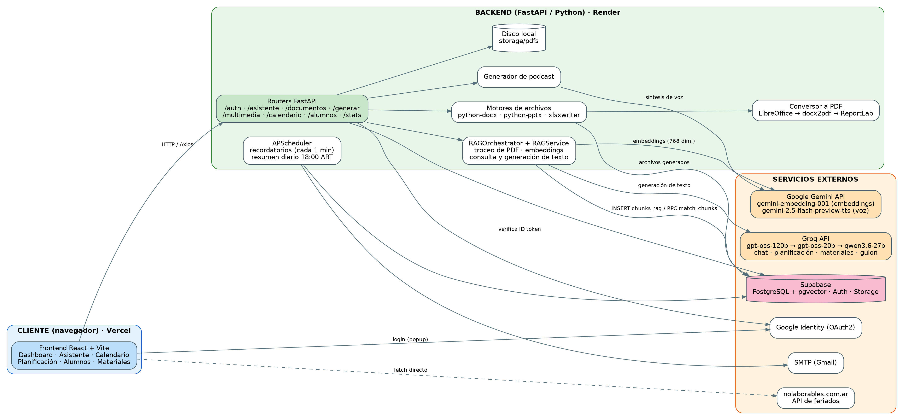
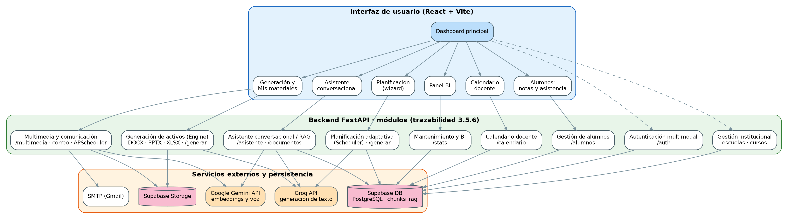
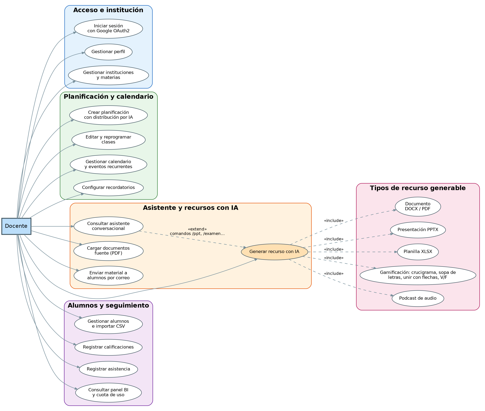
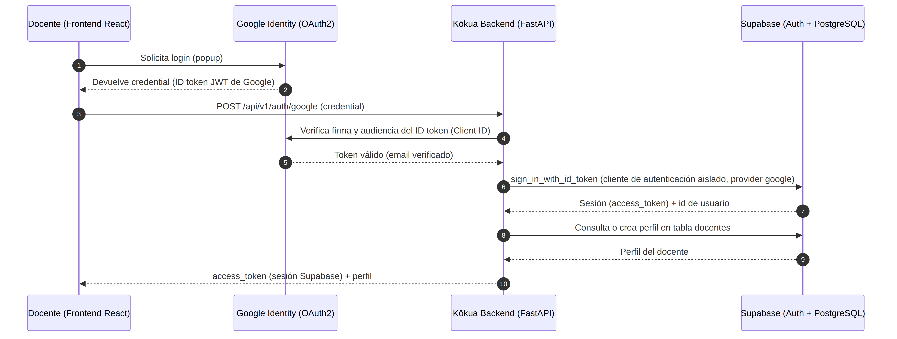
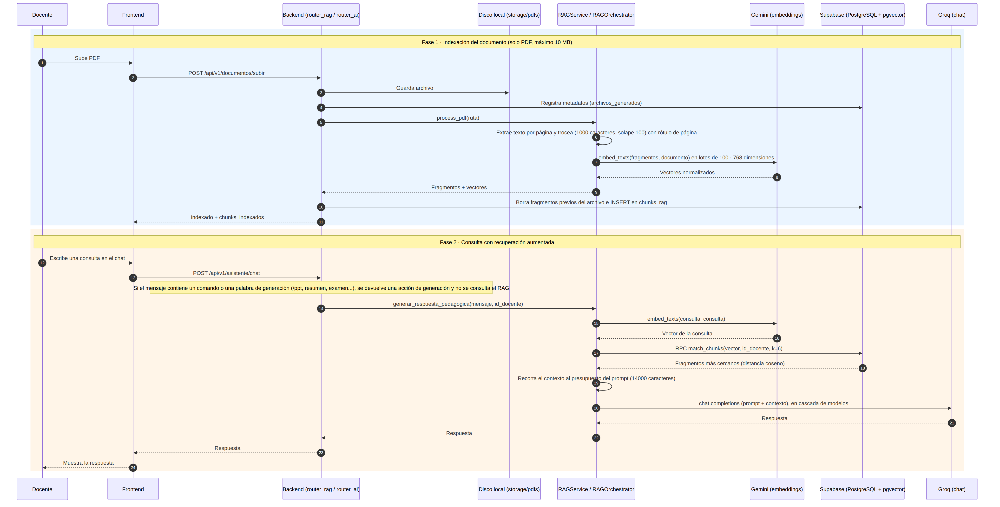
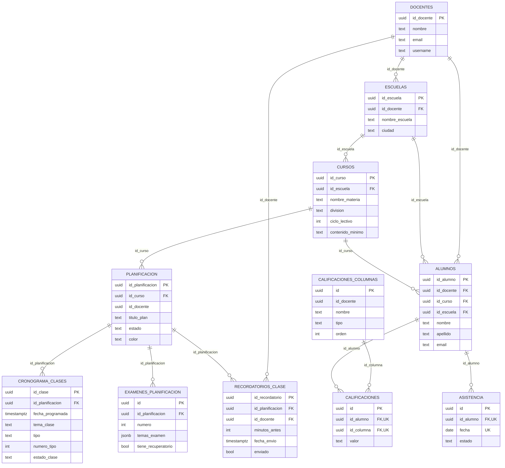
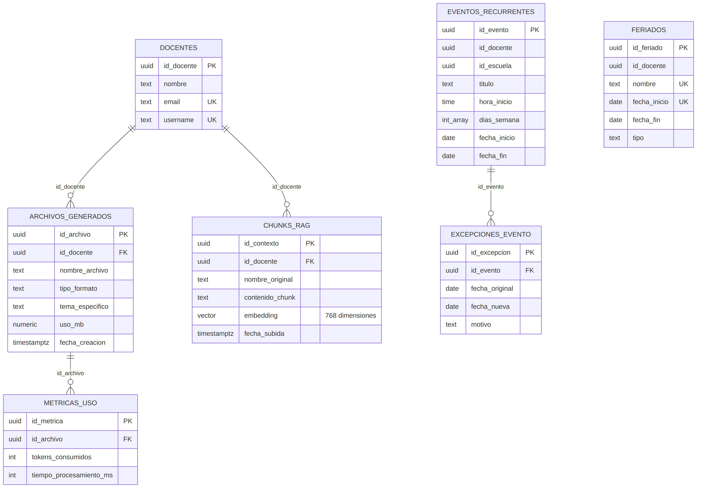

# Kōkua

**Plataforma web basada en Inteligencia Artificial Generativa para la asistencia a docentes de nivel secundario**


Trabajo Final de la carrera de Ingeniería en Sistemas (Práctica Social Tecnológica), Universidad Nacional de Chilecito (UNdeC).

## Contenido

- [Descripción](#descripción)
- [Funcionalidades](#funcionalidades)
- [Arquitectura](#arquitectura)
- [Tecnologías](#tecnologías)
- [Inteligencia artificial](#inteligencia-artificial)
- [Recuperación aumentada (RAG)](#recuperación-aumentada-rag)
- [Modelo de datos](#modelo-de-datos)
- [API REST](#api-rest)
- [Seguridad](#seguridad)
- [Instalación y ejecución local](#instalación-y-ejecución-local)
- [Variables de entorno](#variables-de-entorno)
- [Pruebas](#pruebas)
- [Despliegue](#despliegue)
- [Estructura del repositorio](#estructura-del-repositorio)
- [Limitaciones y trabajo futuro](#limitaciones-y-trabajo-futuro)
- [Documentación y referencias](#documentación-y-referencias)
- [Autoría y agradecimientos](#autoría-y-agradecimientos)
- [Licencia](#licencia)

## Descripción

Kōkua (del hawaiano, "ayuda" o "cooperación") reúne en una sola aplicación las tareas que un docente de secundaria resuelve hoy con herramientas separadas: planificar la cursada, preparar materiales, organizar su agenda y llevar el seguimiento de sus cursos.

El proyecto nació de un relevamiento realizado con instituciones educativas de Chilecito (La Rioja) y Ciudad de Mendoza (Mendoza), donde se detectó que esas tareas se reparten entre muchas aplicaciones sin conexión entre sí. Kōkua las concentra en un único entorno y suma modelos de lenguaje para generar planificaciones, documentos, presentaciones, planillas, actividades de gamificación y podcasts. También incluye un asistente conversacional que puede responder consultas apoyándose en los PDF que el propio docente carga (técnica conocida como RAG, por *Retrieval-Augmented Generation*).

Un criterio de diseño atraviesa todo el proyecto: la herramienta tiene que poder operar con servicios de nivel gratuito, para que su uso no le signifique un costo al docente. Esa decisión condiciona la elección de proveedores de IA (ver [Evolución de los proveedores](#evolución-de-los-proveedores-de-ia)) y define varios de los límites descritos en [Limitaciones y trabajo futuro](#limitaciones-y-trabajo-futuro).

| Dato | Detalle |
|---|---|
| Autora | Daniela Andrea Triador |
| Asesora | Ing. Samira Elizabeth Robador Papich |
| Carrera | Ingeniería en Sistemas, Escuela de Ingeniería, UNdeC |
| Modalidad | Práctica Social Tecnológica |
| Versión | Entrega del Trabajo Final, octubre de 2026 |
| Sitio desplegado | https://kokua-dt.vercel.app |

> El backend está desplegado en el plan gratuito de Render, que puede suspender el servicio tras un período de inactividad. Para reducir las demoras de reactivación, se programó una tarea diaria a las 04:00 h mediante Supabase, horario elegido para minimizar la interferencia con el uso habitual de la plataforma. Esta estrategia busca mejorar la disponibilidad, aunque no garantiza que el servicio permanezca activo.

## Funcionalidades

La numeración RF corresponde a los requerimientos funcionales del Trabajo Final.

| Módulo | Qué permite |
|---|---|
| **Autenticación y perfil** (RF01, RF02) | Registro e inicio de sesión con usuario y contraseña o con cuenta de Google (OAuth2), recuperación de contraseña y perfil del docente. |
| **Instituciones y materias** (RF03, RF30) | Alta de las instituciones donde trabaja el docente y de sus materias, y reasignación de una materia a otra institución. |
| **Planificación adaptativa** (RF04 a RF08) | Asistente por pasos para planificaciones anuales o cuatrimestrales. La IA distribuye los temas de cada unidad entre las clases. Las fechas se calculan a partir del rango lectivo, los días habituales de cursada y los feriados nacionales obtenidos en tiempo real. Permite editar, replanificar o suspender clases y exportar la planificación a Word y PDF. |
| **Calendario docente** (RF09 a RF11, RF28) | Calendario mensual propio, eventos recurrentes con excepciones, feriados propios y recordatorios por correo con anticipación de 1 hora, 1 día o 1 semana. Cada día a las 18:00 (hora de Argentina) se envía un resumen con las clases, exámenes y recuperatorios del día siguiente. |
| **Asistente conversacional y biblioteca** (RF12 a RF14, RF27) | Chat con comandos de barra, biblioteca de materiales generados con descarga y exportación a PDF, y carga de PDF como fuente de consulta. |
| **Generación de recursos** (RF15 a RF19, RF26) | Documentos DOCX con exportación a PDF, presentaciones PPTX, planillas XLSX, actividades de gamificación (crucigrama, sopa de letras, unir con flechas y verdadero o falso) y podcasts en audio. |
| **Alumnos** (RF20 a RF23) | Registro individual e importación masiva por CSV, con asignación de cada alumno a una materia y división (curso). Al importar, los alumnos ya cargados sin curso reciben el curso elegido y no se duplican. Tabla de calificaciones con columnas dinámicas, asistencia por fecha y envío de materiales por correo con mensaje opcional. |
| **Métricas y almacenamiento** (RF24, RF25, RF29) | Registro de métricas de generación, cuota de 50 MB por docente con indicador de uso y panel de estadísticas con una estimación de horas ahorradas (se calcula con un tiempo de referencia por archivo, adoptado como criterio de diseño). |

### Comandos del asistente

| Comando | Acción |
|---|---|
| `/ppt` | Generar una presentación |
| `/resumen` | Generar un apunte o resumen |
| `/preguntas` | Generar preguntas guía |
| `/examen` | Crear un examen rápido |
| `/podcast` | Generar un podcast educativo en audio |
| `/crucigrama` | Generar un crucigrama |
| `/sopa` | Generar una sopa de letras |
| `/ayuda` | Ver la lista de comandos |

El asistente también reconoce estos pedidos escritos en lenguaje natural. Si el mensaje contiene palabras como "presentación", "apunte", "resumen", "examen", "podcast" o "crucigrama", el sistema lo deriva al generador correspondiente y no lo resuelve como una consulta al RAG. Para consultar un documento propio conviene formular preguntas puntuales que no incluyan esas palabras.

## Arquitectura

Kōkua tiene una arquitectura desacoplada. El cliente React se comunica únicamente con la API de FastAPI. El frontend no accede de forma directa a la base de datos ni a los modelos de lenguaje, y las credenciales de los servicios externos existen solo en el backend. La única consulta externa que hace el navegador es la de feriados nacionales, que es pública.



*Figura 1. Arquitectura de solución. Fuente: elaboración propia.*

| Capa | Tecnología | Alojamiento |
|---|---|---|
| Cliente | React y Vite (aplicación de una sola página) | Vercel |
| API | FastAPI (Python) | Render, plan gratuito |
| Datos | Supabase: PostgreSQL con pgvector, Auth y Storage | Supabase |
| Texto generativo | Groq | Servicio externo |
| Embeddings y voz | Google Gemini | Servicio externo |
| Correo | SMTP (Gmail) | Servicio externo |
| Feriados | nolaborables.com.ar, consultado desde el frontend | Servicio externo |
| Tareas programadas | APScheduler dentro del proceso del backend: recordatorios cada minuto y resumen diario a las 18:00 (ART) | Render |

### Módulos



*Figura 2. Mapa de módulos. Fuente: elaboración propia.*

### Casos de uso



*Figura 3. Casos de uso del docente. Fuente: elaboración propia.*

### Flujo de autenticación



*Figura 4. Inicio de sesión con Google. Fuente: elaboración propia.*

Las fuentes editables de todos los diagramas y las instrucciones para regenerarlos están en [`docs/DIAGRAMAS.md`](docs/DIAGRAMAS.md).

## Tecnologías

| Área | Tecnologías |
|---|---|
| Frontend | React 19, Vite 7, Tailwind CSS 4, componentes Radix UI, react-router-dom 7, FullCalendar 6, Recharts, Axios, `@react-oauth/google`, jsPDF y xlsx para exportaciones en el cliente |
| Backend | Python 3.10, FastAPI 0.136 con Uvicorn 0.46, APScheduler 3.11, supabase-py 2.30, google-genai, SDK `openai` 2.36 (usado como cliente compatible con Groq, ver más abajo) |
| Procesamiento de documentos | PyMuPDF, pypdf y PyPDF2 para leer PDF, langchain-text-splitters para fragmentar, python-docx, python-pptx, XlsxWriter y ReportLab para generar archivos, docx2pdf con LibreOffice para convertir a PDF |
| Datos | PostgreSQL con la extensión pgvector (Supabase), Supabase Auth y Supabase Storage |
| Pruebas | pytest 9 y pytest-asyncio |

## Inteligencia artificial

### Proveedores y modelos

| Función | Proveedor | Modelo | Detalle |
|---|---|---|---|
| Generación de texto: asistente, distribución de temas, materiales, guion del podcast | Groq | `openai/gpt-oss-120b`, con respaldo en `openai/gpt-oss-20b` y `qwen/qwen3.6-27b` | Cascada de modelos: si uno falla, se prueba el siguiente |
| Embeddings para el RAG | Google Gemini | `gemini-embedding-001` | 768 dimensiones, vectores normalizados, tipo de tarea distinto para documentos y para consultas |
| Voz del podcast | Google Gemini | `gemini-2.5-flash-preview-tts` | Modelo y voz configurables con `GEMINI_TTS_MODEL` y `GEMINI_TTS_VOICE` |

Cuando el pedido exige una respuesta en JSON (por ejemplo, la distribución de temas o las actividades de gamificación), el orquestador solicita salida estructurada al modelo. Si se agotan los modelos de la cascada, o se supera el límite de tasa de un servicio, el sistema informa al usuario en lugar de fallar en silencio.

### Evolución de los proveedores de IA

El esquema de proveedores cambió durante el desarrollo. El historial del repositorio permite reconstruirlo:

| Fecha | Cambio |
|---|---|
| 16/05/2026 | **Versión inicial.** Embeddings con OpenAI (`text-embedding-3-small`, mediante una clave de OpenAI) y generación de texto con Groq (`llama-3.3-70b-versatile` y `llama-3.1-8b-instant`). |
| 18/05/2026 | **Los embeddings pasan a Google Gemini** (`gemini-embedding-001`). Se elimina la dependencia de la API de OpenAI y de su clave. |
| 15/08/2026 | **Nueva cascada de generación en Groq:** `openai/gpt-oss-120b`, `openai/gpt-oss-20b` y `qwen/qwen3.6-27b`. |
| 21/09/2026 | **Síntesis de voz con Gemini** (`gemini-2.5-flash-preview-tts`) para los podcasts. |
| 25/10/2026 | **Reparación del RAG:** embeddings de 768 dimensiones con normalización, almacenamiento en pgvector con índice HNSW y búsqueda mediante la función SQL `match_chunks`. |

**Por qué se abandonó OpenAI.** La API de embeddings de OpenAI se factura por consumo. Ese esquema de pago dejó de alinearse con el propósito de Kōkua, pensada como una herramienta que el docente pueda usar sin costo. Los embeddings de Gemini cuentan con nivel gratuito, y los modelos de Groq se usan dentro de su plan gratuito.

**Sobre el nombre `openai/...` de los modelos.** Los modelos `openai/gpt-oss-120b` y `openai/gpt-oss-20b` son modelos de pesos abiertos publicados por OpenAI, que Groq sirve desde su propia infraestructura. Kōkua no consume la API de OpenAI ni necesita una clave de OpenAI. El paquete `openai` del backend se usa únicamente como cliente compatible con el endpoint de Groq (`https://api.groq.com/openai/v1`).


### Límites que condicionan el diseño

- **Prompt hacia Groq.** El texto enviado al modelo se limita a 14.000 caracteres, para respetar los límites de tokens del nivel gratuito.
- **Embeddings de Gemini.** Según la documentación oficial de Google, el nivel gratuito admite 30.000 tokens de entrada por minuto. Un documento de más de 30 a 40 páginas puede no indexarse por completo. Los límites exactos de cada proyecto se consultan en [Google AI Studio](https://aistudio.google.com/).

## Recuperación aumentada (RAG)

El docente carga PDF propios y el asistente responde sus consultas con fragmentos de esos documentos como contexto. Cada docente consulta únicamente su propio material.



*Figura 5. Indexación de un PDF y consulta con recuperación aumentada. Fuente: elaboración propia.*

### Indexación

1. El docente sube un PDF desde la interfaz (`POST /api/v1/documentos/subir`).
2. El backend guarda el archivo, registra sus metadatos y extrae el texto página por página.
3. Cada página se divide en fragmentos de 1.000 caracteres con un solapamiento de 100, y cada fragmento lleva el número de su página de origen.
4. Gemini convierte los fragmentos en vectores de 768 dimensiones, en lotes de 100.
5. Los vectores se guardan en la tabla `chunks_rag`, junto con el identificador del docente y el nombre del documento.

Si el docente vuelve a cargar un archivo con el mismo nombre, sus fragmentos anteriores se reemplazan. Si el PDF se guarda pero la indexación falla (por ejemplo, un PDF escaneado sin texto o una cuota agotada), la subida no se rechaza: la respuesta informa `indexado: false` con el motivo, y el chat y la sección Mis materiales avisan al docente.

### Consulta

1. El docente escribe una pregunta en el chat.
2. El mensaje se vectoriza con el mismo modelo.
3. La función SQL `match_chunks` devuelve los seis fragmentos más cercanos por distancia coseno, restringidos al docente que consulta.
4. Esos fragmentos se incorporan al prompt, que se recorta al presupuesto de 14.000 caracteres sin cortar nunca el pedido original.
5. Groq genera la respuesta mediante la cascada de modelos.

Para generar un material a partir de un PDF largo, el sistema selecciona los fragmentos más relevantes del documento en lugar de usar solo las primeras páginas.

### Parámetros

| Parámetro | Valor |
|---|---|
| Formato admitido | PDF con texto extraíble |
| Tamaño máximo por archivo | 10 MB (límite de la interfaz) |
| Fragmentación | Por página, 1.000 caracteres, solapamiento de 100 |
| Embeddings | `gemini-embedding-001`, 768 dimensiones, normalizados |
| Almacenamiento vectorial | Tabla `chunks_rag` con pgvector, índice HNSW y distancia coseno |
| Recuperación | Función `match_chunks`, filtrada por docente, 6 fragmentos |
| Presupuesto del prompt | 14.000 caracteres |
| Al eliminar un archivo | Se eliminan también sus fragmentos |

## Modelo de datos

La base de datos es PostgreSQL en Supabase, con la extensión pgvector. El esquema `public` tiene 22 tablas. Los diagramas muestran las que usa la versión actual del sistema, con sus columnas principales. Cinco tablas del modelo anterior de planificación (`clases`, `examenes`, `recuperatorios`, `clases_examenes` y `clases_recuperatorios`) se conservan por compatibilidad y no se grafican.



*Figura 6. Modelo entidad-relación, núcleo académico. Fuente: elaboración propia.*



*Figura 7. Modelo entidad-relación, archivos, RAG y calendario. Fuente: elaboración propia.*

Las líneas representan claves foráneas declaradas en la base. Varias tablas (`planificacion`, `calificaciones_columnas`, `calificaciones`, `asistencia`, `eventos_recurrentes` y `feriados`) usan `id_docente` como criterio de filtrado, sin una clave foránea declarada hacia `docentes`. La integridad de las planificaciones se apoya en borrado en cascada: al eliminar una materia o una institución se eliminan también su planificación, su cronograma, sus exámenes y sus recordatorios. Las calificaciones y la asistencia tienen restricciones `UNIQUE` compuestas (alumno y columna, alumno y fecha).

### Migraciones

Las migraciones están en `backend/migrations/`. Aplicalas en orden cronológico desde el SQL Editor de Supabase.

| Archivo | Qué hace |
|---|---|
| `20260822_alumnos_planificacion.sql` | Migración aditiva para agrupar alumnos por institución y asignar colores a las planificaciones |
| `20260824_planificacion_temas_numeracion.sql` | Guarda etiquetas independientes y temas de evaluación sin alterar el orden del cronograma |
| `20261025_rag_chunks.sql` | Renombra `documentos_contexto` a `chunks_rag`, fija la columna `embedding` en `vector(768)`, crea los índices y la función `match_chunks`. Se detiene si la tabla ya tiene filas, para no borrar datos |
| `20261027_alumnos_asignatura.sql` | Agrega un índice sobre `alumnos.id_curso` y completa `id_escuela` en los alumnos que ya tienen curso y no tienen escuela. La relación entre alumno y curso ya existía en el esquema, por lo que la migración no la modifica ni borra datos |

Los scripts `seed_data.py`, `seed_feriados.py` y `migrate_*.py` de la carpeta `backend/` son de apoyo y de migraciones anteriores. Revisalos antes de ejecutarlos contra una base que ya tenga datos.

## API REST

La documentación interactiva (Swagger UI) está disponible en `/docs` cuando el backend está en ejecución, por ejemplo `http://localhost:8000/docs`. Todos los endpoints cuelgan de `/api/v1`.

| Prefijo | Contenido |
|---|---|
| `/auth` | Registro, inicio de sesión, inicio de sesión con Google, perfil, cambio y recuperación de contraseña, y `GET /whoami` (diagnóstico de sesión) |
| `/documentos` | Carga de PDF e indexación para el RAG |
| `/asistente` | Chat del asistente y reconocimiento de comandos |
| `/generar` | Generación de recursos: planificación, documentos, presentaciones, planillas y actividades de gamificación, con sus exportaciones |
| `/multimedia` | Guion del podcast |
| `/calendario` | Eventos, excepciones, feriados propios y vista mensual |
| `/alumnos` | Alumnos, importación por CSV, envío de materiales, calificaciones y asistencia |
| `/proyectos` | Instituciones, materias, estadísticas del tablero y archivos del docente |
| `/stats` | Panel de Business Intelligence |
| `/externo` | Sugerencia de herramientas (interoperabilidad) |
| `/planning` y `/gamificacion` | Rutas heredadas, conservadas por compatibilidad |

El frontend envía el token de sesión en la cabecera `Authorization: Bearer <token>`.

## Seguridad

- **Autenticación delegada.** Las credenciales las gestiona Supabase Auth. En el inicio de sesión con Google, el backend verifica la firma y la audiencia del token de identidad con `google-auth` antes de crear la sesión.
- **Cliente de autenticación aislado.** El inicio de sesión, el registro y la verificación de la contraseña actual se hacen con un cliente de Supabase descartable (`crear_cliente_auth`, en `backend/app/core/auth_client.py`). El motivo es que un inicio de sesión sobre el cliente compartido cambia la credencial con la que el backend consulta la base para todas las solicitudes siguientes.
- **Validación de tokens.** La dependencia `get_current_user` (`backend/app/core/security.py`) valida el token con Supabase Auth. Responde 401 ante un token ausente, alterado, vencido o de una sesión cerrada, y 503 ante una falla del servicio de autenticación. Los errores inesperados no se ocultan. Se verificó con credenciales reales y hoy protege el endpoint `GET /api/v1/auth/whoami`. Extenderla al resto de las rutas es la mejora de seguridad prioritaria (ver [Limitaciones](#limitaciones-y-trabajo-futuro)).
- **Aislamiento entre docentes.** El identificador de cada docente coincide con el de su cuenta en Supabase Auth, y las consultas del backend filtran por ese identificador, incluida la recuperación de fragmentos del RAG. Todas las tablas tienen habilitada la seguridad a nivel de fila (RLS). El backend accede con la clave de servicio y el frontend no se comunica con la base.
- **Archivos.** El bucket `documentos_docentes` es privado. Las descargas se entregan con URLs firmadas que vencen a los 7 días.
- **Secretos.** Las claves se leen de variables de entorno y no se versionan. La clave `SUPABASE_SERVICE_KEY` nunca debe incluirse en el frontend.

## Instalación y ejecución local

### Requisitos previos

- Git
- Python 3.10
- Node.js 20.19 o superior (requisito de Vite 7)
- Un proyecto de [Supabase](https://supabase.com/)
- Claves de API de [Groq](https://console.groq.com/) y de [Google Gemini](https://aistudio.google.com/)
- Un ID de cliente OAuth 2.0 de Google (tipo aplicación web), si querés habilitar el inicio de sesión con Google
- Opcional: LibreOffice, para convertir DOCX a PDF. Sin él, el sistema usa los conversores alternativos (docx2pdf y ReportLab)
- Opcional: una cuenta SMTP (por ejemplo, Gmail con contraseña de aplicación) para el envío de correos

### 1. Clonar el repositorio

```bash
git clone https://github.com/DTriador/Trabajo-Final.git
cd Trabajo-Final
```

### 2. Preparar Supabase

1. Creá un proyecto y copiá la URL, la clave anónima (`anon`) y la clave de servicio (`service_role`).
2. Creá un bucket **privado** llamado `documentos_docentes` en Storage.
3. En Authentication, Providers, habilitá Google con tu ID de cliente y su secreto, si vas a usar ese acceso.
4. Creá las tablas del esquema `public` según los diagramas de [Modelo de datos](#modelo-de-datos) y aplicá las migraciones de `backend/migrations/` en orden.

> El esquema base de tablas no está exportado como un único archivo SQL en el repositorio. Las migraciones agregan o modifican sobre un esquema existente. Para reproducir la base desde cero, guiate por los diagramas A6a y A6b y por las restricciones descritas arriba. Exportar el esquema completo es una mejora pendiente.

### 3. Configurar Google OAuth

En Google Cloud Console, en el cliente OAuth que usás, agregá como orígenes de JavaScript autorizados `http://localhost:5173` y la URL de producción del frontend. Los cambios pueden tardar unos minutos en aplicarse.

### 4. Backend

Desde la carpeta `backend`:

```bash
cd backend
python3.10 -m venv venv
source venv/bin/activate        # en Windows: venv\Scripts\activate
pip install -r requirements.txt
```

Creá el archivo `backend/.env` con las variables descritas en [Variables de entorno](#variables-de-entorno) y levantá el servidor:

```bash
uvicorn app.main:app --reload --port 8000
```

El backend queda en `http://localhost:8000` y la documentación interactiva en `http://localhost:8000/docs`. Siempre ejecutá el comando desde la carpeta `backend`, porque los imports usan el paquete `app`.

> Al iniciar, el backend arranca el programador de tareas (recordatorios y resumen diario). Si tu `.env` local apunta a la misma base que producción y tiene SMTP configurado, el backend local también podría enviar correos reales. Para probar, dejá vacías las variables `SMTP_*`.

### 5. Frontend

En otra terminal, desde la carpeta `frontend`:

```bash
cd frontend
npm install
```

Creá el archivo `frontend/.env.local`:

```
VITE_API_URL=http://localhost:8000/api/v1
VITE_GOOGLE_CLIENT_ID=<tu ID de cliente de Google>
```

Después ejecutá:

```bash
npm run dev
```

La aplicación queda en `http://localhost:5173`. Sin `VITE_API_URL`, las llamadas irían al propio servidor de Vite y devolverían 404. Si cambiás el `.env.local`, reiniciá `npm run dev`.

### 6. Verificación

1. Abrí `http://localhost:8000/docs`. Tiene que mostrar la documentación de la API.
2. Registrate o iniciá sesión desde `http://localhost:5173`.
3. Subí un PDF desde el chat y, en la terminal del backend, comprobá que aparece una línea con la cantidad de fragmentos indexados.
4. Preguntale al asistente por un dato que solo esté en ese documento.

## Variables de entorno

### Backend (`backend/.env`)

| Variable | Obligatoria | Uso |
|---|---|---|
| `SUPABASE_URL` | Sí | URL del proyecto de Supabase |
| `SUPABASE_SERVICE_KEY` | Sí | Clave de servicio con la que el backend consulta la base. No se debe exponer |
| `SUPABASE_ANON_KEY` | Recomendada | Clave con la que se crea el cliente de autenticación. Si falta, se usa la clave de servicio |
| `GROQ_API_KEY` | Sí | Generación de texto |
| `GEMINI_API_KEY` | Sí | Embeddings del RAG y voz del podcast |
| `GOOGLE_CLIENT_ID` | Para el acceso con Google | ID de cliente OAuth 2.0, el mismo que usa el frontend |
| `GEMINI_TTS_MODEL` | No | Modelo de síntesis de voz. Valor por defecto: `gemini-2.5-flash-preview-tts` |
| `GEMINI_TTS_VOICE` | No | Voz de la síntesis de audio |
| `SMTP_HOST`, `SMTP_PORT`, `SMTP_USER`, `SMTP_PASSWORD`, `SMTP_FROM_NAME` | Para el envío de correos | Recordatorios, resumen diario y envío de materiales a alumnos |

Ejemplo de estructura, con valores de relleno:

```
SUPABASE_URL=https://xxxxxxxxxxxxxxxxxxxx.supabase.co
SUPABASE_SERVICE_KEY=...
SUPABASE_ANON_KEY=...
GROQ_API_KEY=...
GEMINI_API_KEY=...
GOOGLE_CLIENT_ID=...
SMTP_HOST=smtp.gmail.com
SMTP_PORT=587
SMTP_USER=...
SMTP_PASSWORD=...
SMTP_FROM_NAME=Kōkua
```

### Frontend (`frontend/.env.local`)

| Variable | Obligatoria | Uso |
|---|---|---|
| `VITE_API_URL` | Sí | URL base de la API, por ejemplo `http://localhost:8000/api/v1` |
| `VITE_GOOGLE_CLIENT_ID` | Para el acceso con Google | ID de cliente OAuth 2.0 de Google |

## Pruebas

Las pruebas automáticas están en `backend/tests/` y no necesitan conexión a Supabase, Gemini ni Groq, porque simulan esos servicios. Cubren autenticación (validación de tokens y cliente aislado), embeddings, indexación y consulta del RAG, extracción de PDF, borrado de fragmentos, exportación de planificaciones y diseño de presentaciones.

Desde la raíz del repositorio, con el entorno virtual activo:

```bash
PYTHONPATH=backend python -m pytest backend/tests -q
```

Las simulaciones no reemplazan la verificación contra los servicios reales. Las pruebas funcionales, de integración, de recuperación ante errores y de usabilidad con docentes, junto con la tabla de pruebas manuales, están documentadas en la sección 3.5 del Trabajo Final.

## Despliegue

Configuración de referencia para los servicios en los que corre la versión desplegada.

**Backend en Render** (servicio web, plan gratuito)

| Campo | Valor |
|---|---|
| Directorio raíz | `backend` |
| Comando de compilación | `pip install -r requirements.txt` |
| Comando de inicio | `uvicorn app.main:app --host 0.0.0.0 --port $PORT` |
| Variables de entorno | Las de la tabla de [Variables de entorno](#variables-de-entorno) |

**Frontend en Vercel**

| Campo | Valor |
|---|---|
| Directorio raíz | `frontend` |
| Framework | Vite |
| Comando de compilación | `npm run build` |
| Directorio de salida | `dist` |
| Variables de entorno | `VITE_API_URL` apuntando al backend de Render, y `VITE_GOOGLE_CLIENT_ID` |

El archivo `frontend/vercel.json` redirige todas las rutas a `index.html`, necesario para que funcione el enrutado de la aplicación de una sola página.

**CORS.** Los orígenes permitidos están en `backend/app/main.py`. Si cambia la URL del frontend, hay que agregarla a esa lista.

**Archivos subidos.** Los PDF que carga el docente se guardan en la carpeta `storage/pdfs` del servidor. En Render, sin disco persistente, esos archivos se pierden con cada despliegue. Los fragmentos indexados para el RAG no se pierden, porque están en la base de datos.

## Estructura del repositorio

```
.
├── backend/
│   ├── app/
│   │   ├── api/          Routers y generadores de contenido (planificación, gamificación, exportaciones)
│   │   ├── core/         Conexión a la base, seguridad y cliente de autenticación
│   │   ├── services/     Lógica de negocio: RAG, embeddings, correo, estadísticas, podcast, autenticación
│   │   ├── utils/        Motores de archivos (DOCX, PPTX, XLSX), almacenamiento y tema visual
│   │   └── main.py       Aplicación FastAPI, CORS y registro de routers
│   ├── migrations/       Migraciones SQL
│   ├── tests/            Pruebas automáticas
│   ├── seed_data.py      Scripts de apoyo y migraciones anteriores
│   └── requirements.txt
├── frontend/
│   ├── src/
│   │   ├── views/        Pantallas: tablero, alumnos, biblioteca, calendario, materiales, estadísticas, perfil
│   │   └── components/dashboard/   Planificación, chat, calendario, subida de archivos, cuota de almacenamiento
│   ├── vercel.json
│   └── package.json
├── docs/
│   ├── DIAGRAMAS.md      Diagramas del sistema con sus fuentes editables
│   └── diagramas/        Imágenes PNG y archivos fuente (Graphviz y Mermaid)
├── Gantt/                Cronograma del proyecto
└── test_scripts/         Scripts de prueba auxiliares
```

## Limitaciones y trabajo futuro

**Limitaciones conocidas**

- **Formatos.** Solo se indexan PDF con texto extraíble, de hasta 10 MB. Los PDF escaneados, sin texto, no sirven como contexto, y los documentos de Word, PowerPoint y Excel no se indexan.
- **Alcance de la consulta.** El asistente recupera seis fragmentos por pregunta, que equivalen a unos seis mil caracteres. Sirve para preguntas sobre pasajes concretos, pero no para resumir un documento completo.
- **Cuota de embeddings.** Con el nivel gratuito de Gemini, los documentos de más de unas 30 a 40 páginas pueden no indexarse por completo. En ese caso el archivo se guarda y la interfaz avisa que no quedó disponible para las consultas (el aviso existe en el chat y en Mis materiales).
- **Autenticación por ruta.** La validación de tokens existe y está probada, pero hoy solo protege `GET /auth/whoami`. En el resto de las rutas, el identificador del docente llega desde el frontend y el backend no lo contrasta con el token de sesión. La mejora prioritaria es aplicar `get_current_user` a todas las rutas, comparar la identidad con la del token y definir políticas RLS por docente.
- **Propiedad de archivos.** Los endpoints que operan sobre un archivo por su identificador (por ejemplo, eliminarlo) todavía no verifican que pertenezca al docente que lo solicita. Se resuelve con el punto anterior.
- **Almacenamiento de PDF.** Los archivos cargados se guardan en el disco del servidor, que en Render no es persistente.
- **Esquema base.** No hay un archivo SQL con el esquema completo, solo migraciones incrementales.
- **Rutas heredadas.** Existen rutas y tablas del modelo anterior de planificación y de gamificación que se conservan por compatibilidad.
- **Arranque en frío.** El plan gratuito de Render suspende el servicio por inactividad, con latencias de hasta 60 segundos en el primer acceso.

**Trabajo futuro**

- Aplicar la validación de tokens y las políticas RLS por docente en todo el sistema.
- Indexar documentos en segundo plano, con indicación de progreso, y respetar la cuota de la API de embeddings con pausas entre lotes.
- Resumir documentos completos por etapas.
- Aceptar otros formatos de documento además de PDF.
- Sincronizar el calendario con Google Calendar.
- Exportar el esquema completo de la base como SQL versionado.

## Documentación y referencias

- [`docs/DIAGRAMAS.md`](docs/DIAGRAMAS.md): diagramas del sistema y fuentes editables.
- Trabajo Final completo (Universidad Nacional de Chilecito): contiene los requerimientos funcionales y no funcionales, la metodología, el análisis de costos y límites de los servicios, las pruebas y la trazabilidad.

Documentación de las tecnologías principales:

- [FastAPI](https://fastapi.tiangolo.com/)
- [React](https://react.dev/) y [Vite](https://vite.dev/)
- [FullCalendar](https://fullcalendar.io/)
- [APScheduler](https://apscheduler.readthedocs.io/)
- [Supabase](https://supabase.com/docs) y [pgvector](https://github.com/pgvector/pgvector)
- [Groq](https://console.groq.com/docs)
- [API de embeddings de Gemini](https://ai.google.dev/gemini-api/docs/embeddings) y [límites de uso](https://ai.google.dev/gemini-api/docs/rate-limits)
- [Render](https://render.com/docs) y [Vercel](https://vercel.com/docs)
- [API de feriados nacionales de Argentina](https://nolaborables.com.ar/)

## Autoría y agradecimientos

**Autora:** Daniela Andrea Triador ([@DTriador](https://github.com/DTriador)).

**Asesora:** Ing. Samira Elizabeth Robador Papich.

**Equipo de cátedra de Trabajo Final:** Ing. Mara Rovero, Ing. Matias Perez e Ing. Raul Moralejo.

Un agradecimiento especial a las instituciones y a los docentes de Chilecito que participaron del relevamiento de necesidades y de las pruebas de usabilidad.

## Licencia

Este repositorio no incluye una licencia de código abierto. Su uso, copia o redistribución requieren la autorización de la autora.
